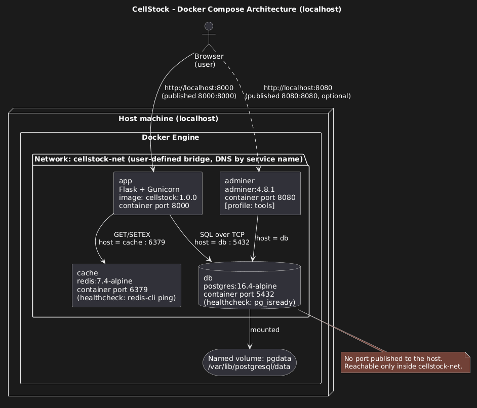
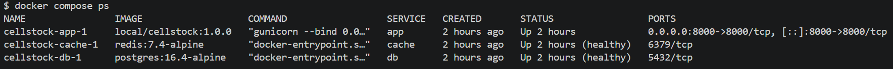
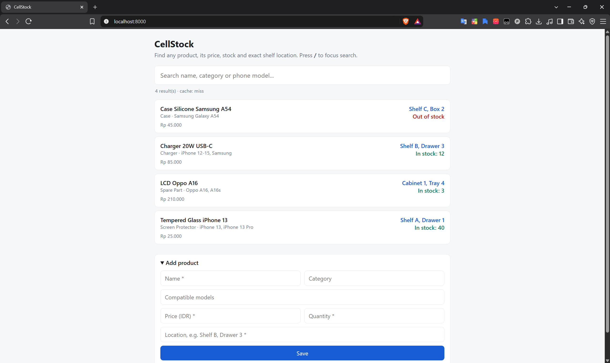
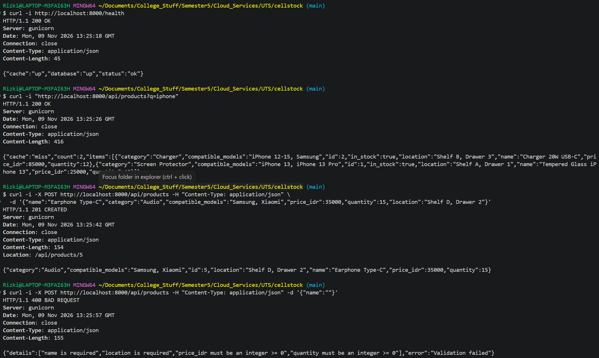
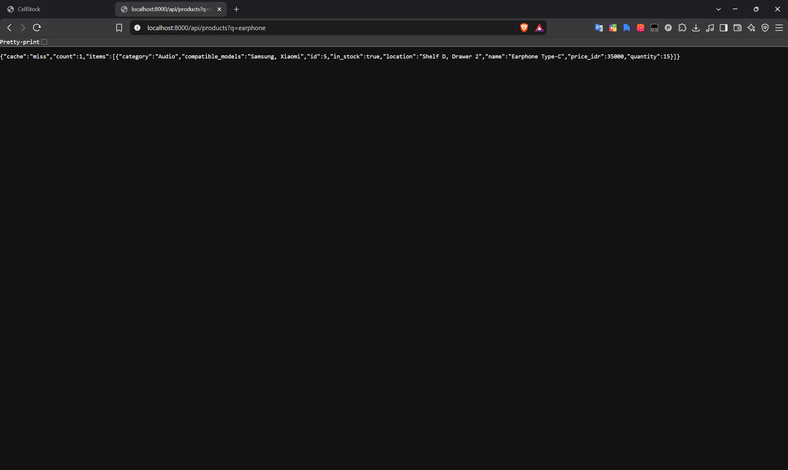
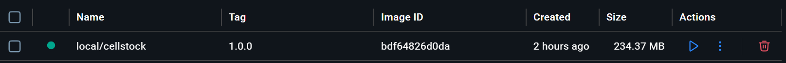

# CellStock

A small multi-tier inventory lookup app for a cellular shop: one fast search bar that shows **availability, stock quantity, price and exact shelf location** (e.g. "Shelf B, Drawer 3").
Everything runs in containers on localhost with a single command.

## Why this project

I help at my father's cellular shop, where prices, stock and item locations live in the owner's memory. Every handover or busy hour turns into "where is the charger?" interruptions. CellStock moves that knowledge into a database anyone at the counter can search in seconds.
I'm also an aspiring DevOps engineer, so containerizing it end-to-end was the point of the exercise.

## Architecture



| Service   | Image                  | Host port        | Purpose                              |
|-----------|------------------------|------------------|--------------------------------------|
| `app`     | built from `Dockerfile`| `8000` -> 8000   | Flask API + static frontend          |
| `db`      | `postgres:16.4-alpine` | none (internal)  | PostgreSQL, data in named volume `pgdata` |
| `cache`   | `redis:7.4-alpine`     | none (internal)  | Caches search results (30 s TTL)     |
| `adminer` | `adminer:4.8.1`        | `8080` -> 8080   | DB UI, only with `--profile tools`   |

All services share the user-defined network `cellstock-net`; the app reaches the database at host `db` and Redis at host `cache` (service names, never IPs or localhost).

## API

| Method | Path                    | Success | Errors                      |
|--------|-------------------------|---------|-----------------------------|
| GET    | `/health`               | 200     | 503 if the database is down |
| GET    | `/api/products?q=term`  | 200     |                             |
| POST   | `/api/products`         | 201     | 400 invalid body, 409 duplicate name |

Example:

```bash
curl -i http://localhost:8000/health
curl -i "http://localhost:8000/api/products?q=iphone"
curl -i -X POST http://localhost:8000/api/products \
  -H "Content-Type: application/json" \
  -d '{"name":"Earphone Type-C","category":"Audio","compatible_models":"Samsung, Xiaomi","price_idr":35000,"quantity":15,"location":"Shelf D, Drawer 2"}'
```

## Run it

Requirements: Docker Desktop (or Docker Engine) with Compose v2.

```bash
git clone https://github.com/<your-username>/cellstock.git
cd cellstock
cp .env.example .env        # then change POSTGRES_PASSWORD
docker compose up -d --build
```

Open <http://localhost:8000>.

Optional DB admin UI: `docker compose --profile tools up -d` then <http://localhost:8080> (System: PostgreSQL, Server: `db`, credentials from `.env`).

Persistence test:

```bash
docker compose down          # removes containers, KEEPS the pgdata volume -> data survives
docker compose up -d
docker compose down -v       # also deletes the volume -> data is wiped, seed data re-created on next up
```

## Docker concepts demonstrated

- Multi-stage build (builder -> runtime), pinned base image tags, dependency file copied before source for layer caching
- Non-root runtime user, exec-form `CMD`, `.dockerignore`
- User-defined network + service-name DNS, named volume, healthchecks with `depends_on: condition: service_healthy`
- Config from `.env` (only `.env.example` is committed), one Compose profile (`tools`), Redis cache with healthcheck

## Screenshots

<!-- Replace with your real screenshots -->
| `docker compose ps` | Application | curl tests | Persistence test |
|---|---|---|---|
|  |  |  |  |

Image size (`docker images`): 

## Links

- Article: https://medium.com/@pratamawae489/from-ask-the-owner-to-a-search-bar-containerizing-cellstock-with-docker-compose-fb15b8f85192
- Video demo: https://youtu.be/mVuxd2cm2OY

## Sources and credits

- Python base image, PostgreSQL, Redis and Adminer official images from Docker Hub
- Open-source libraries: Flask, Gunicorn, psycopg, redis-py (see `app/requirements.txt`)
- No framework starter/generator was used; the app was written for this exam.

